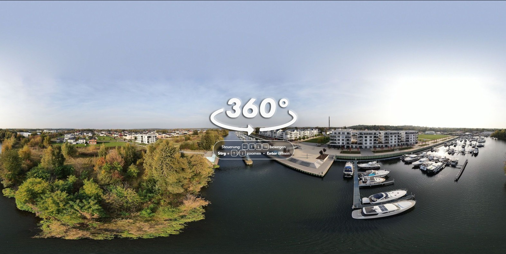
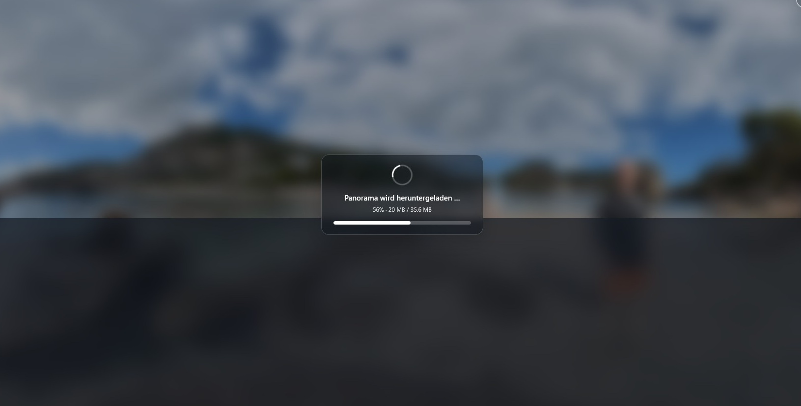
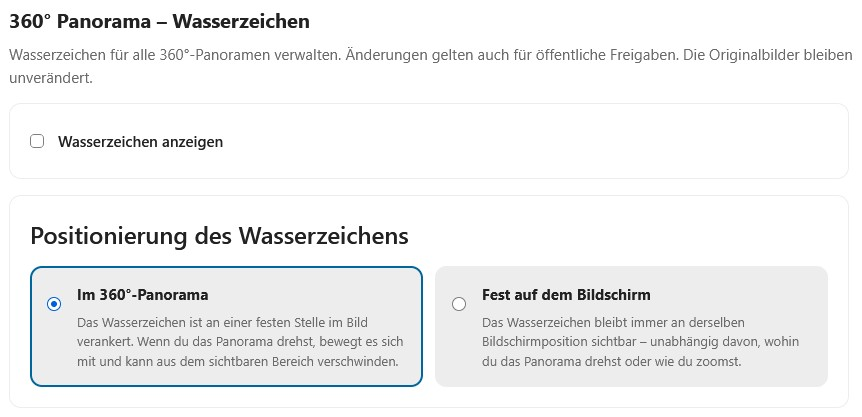
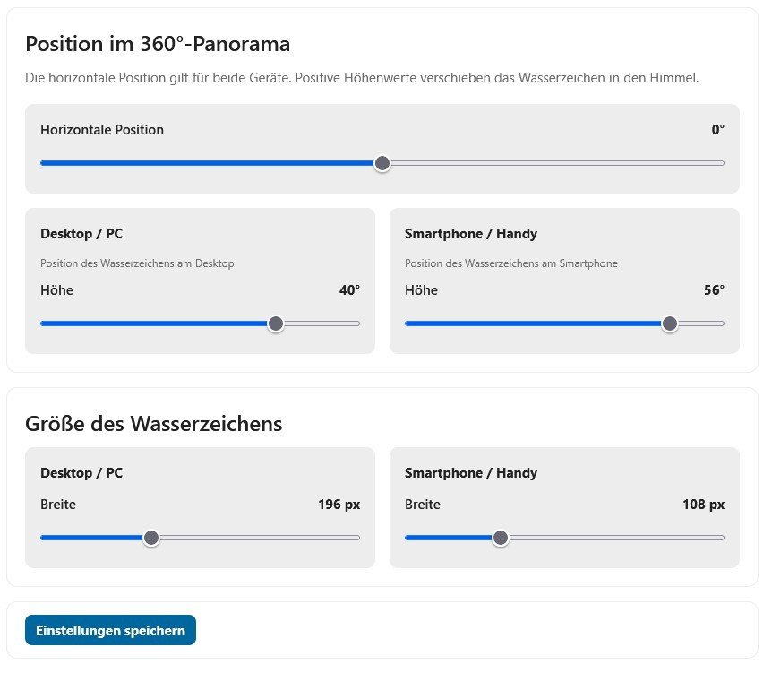
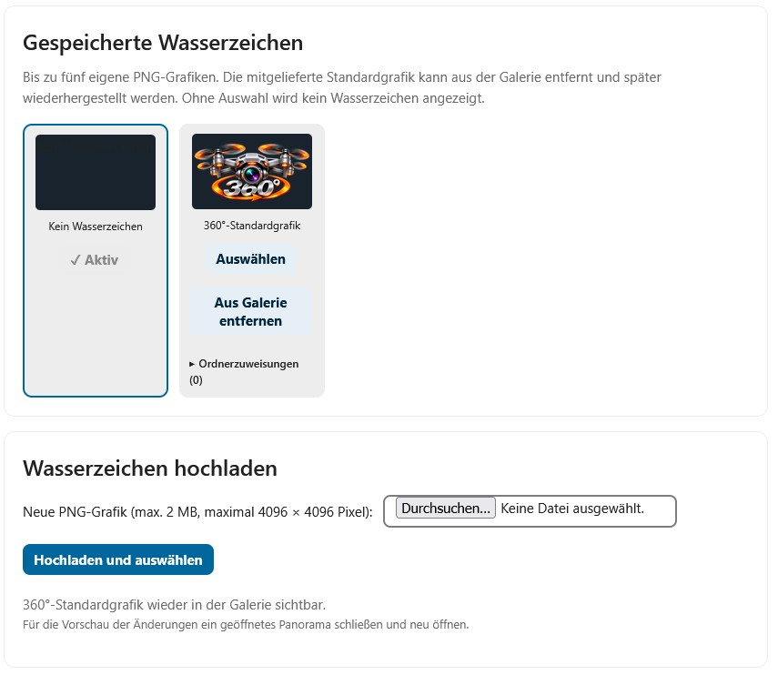
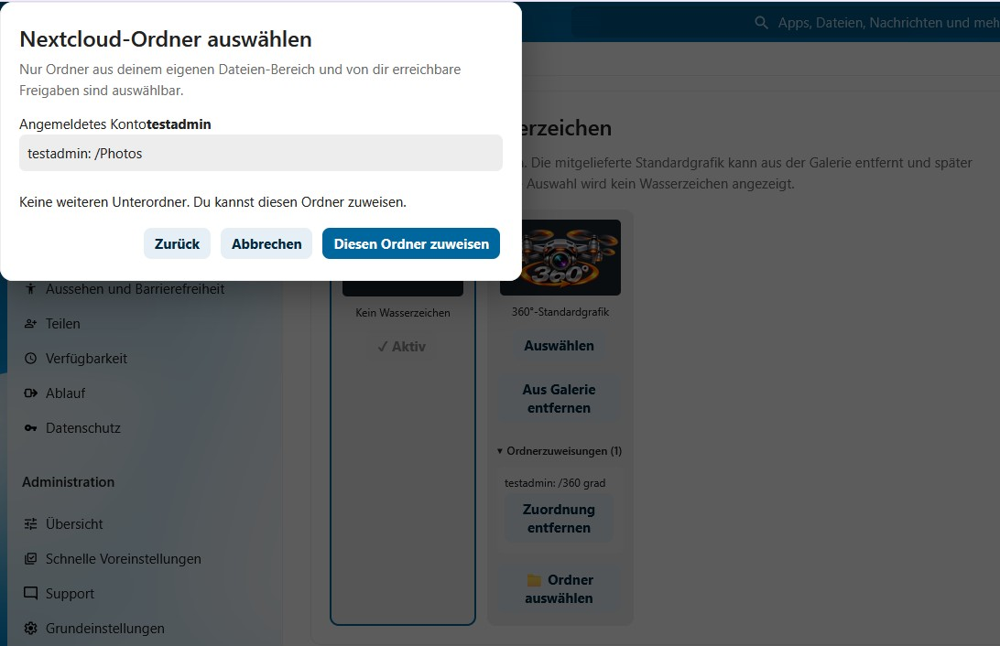

# Photo Sphere – 360° Panorama

**Interaktiver 360°-Panoramabetrachter für Nextcloud**

Photo Sphere erweitert Nextcloud um die Möglichkeit,
360°-Panoramafotos direkt in Fotos, Dateien und
öffentlichen Freigaben interaktiv zu betrachten.

Die App verfügt über einen eigenen WebGL-basierten
Panoramabetrachter sowie eine umfangreiche
Verwaltung individueller Wasserzeichen.

**Version:** 0.4.18 Release Candidate
**Kompatibilität:** Nextcloud 35
**Lizenz:** AGPL-3.0-or-later
**Entwickler:** Stefan Sührer

---

## Funktionen

### 360°-Panoramabetrachter

- Automatische Erkennung geeigneter JPEG-Panoramen
  anhand von XMP-Metadaten
- Integrierter WebGL-basierter Panorama-Renderer
- Unterstützung für Nextcloud Fotos und Dateien
- Maus-, Tastatur- und Touchsteuerung
- Sanftes Beschleunigen und Abbremsen bei
  der Navigation mit Pfeiltasten
- Stufenloser Zoom
- Visuelle Ladeanzeige mit JPEG-Downloadfortschritt
- Unterstützung öffentlicher Datei- und Ordnerfreigaben
- Originalbilder bleiben unverändert

### Individuelle Wasserzeichen

- Eigene transparente PNG-Wasserzeichen hochladen
- Verwaltung über eine integrierte Bildergalerie
- Mitgeliefertes Standardwasserzeichen
- Wasserzeichen aktivieren oder deaktivieren
- Größe und Position individuell konfigurieren
- Unterschiedliche Einstellungen für Desktop und Mobilgeräte
- Feste Bildschirmposition oder Position im Panorama

### Ordnerbezogene Wasserzeichen

- Wasserzeichen bestimmten Ordnern zuweisen
- Integrierter Nextcloud-Ordnerbrowser
- Automatische Vererbung an Unterordner
- Spezifischere Ordnerregeln haben Vorrang
- Fallback auf das konfigurierte Standardwasserzeichen
- Ordnerzugriff entsprechend den Berechtigungen
  des angemeldeten Administratorkontos

### Öffentliche Freigaben

Photo Sphere unterstützt die interaktive
Panoramaansicht in geeigneten öffentlichen
Nextcloud-Freigaben.

Dazu gehören auch passwortgeschützte Freigaben.

Die dateibezogene Wasserzeichenauflösung
berücksichtigt Freigabetyp, Leseberechtigungen
und die Authentifizierung geschützter Freigaben.

---

## Screenshots

### Interaktiver 360°-Panoramabetrachter

Der vollständig geladene Panoramabetrachter mit
integriertem Wasserzeichen.

### 360°-Startansicht

Panorama mit eingeblendeter 360°-Schaltfläche
und Steuerungshinweisen.

### Ladefortschritt

Während des JPEG-Downloads zeigt Photo Sphere
den Fortschritt mit einer visuellen Ladeanzeige an.

### Wasserzeichen aktivieren und positionieren

Der Administrationsbereich bietet verschiedene
Positionierungsarten für Wasserzeichen.

### Position und Größe konfigurieren

Die Positionierung und Größe lassen sich
für Desktop und Smartphone getrennt einstellen.

### Wasserzeichen-Galerie

Eigene PNG-Wasserzeichen können hochgeladen,
ausgewählt und verwaltet werden.

### Ordnerbezogene Wasserzeichen

Wasserzeichen lassen sich über einen integrierten
Ordnerbrowser bestimmten Nextcloud-Ordnern zuweisen.

---

## Voraussetzungen

- Nextcloud 35
- Nextcloud Photos
- Nextcloud Viewer
- Moderner Browser mit WebGL-Unterstützung

Die zusätzliche Nextcloud-App `files_photospheres`
ist für den integrierten Panorama-Renderer
nicht erforderlich.

---

## Verwaltung

Die Wasserzeichenverwaltung befindet sich
in den Nextcloud-Verwaltungseinstellungen
unter **360° Panorama**.

Dort können Administratoren Wasserzeichen
hochladen, auswählen, positionieren und
bestimmten Ordnern zuweisen.

Die Original-JPEG-Dateien werden durch die
Wasserzeichenanzeige nicht verändert.

---

## Teststatus

Version 0.4.18 wurde in einer isolierten
Docker-Testumgebung mit folgenden Komponenten
manuell geprüft:

- Nextcloud 35.0.3
- Nextcloud Photos 8.0.0
- Nextcloud Viewer 8.0.0
- ARM64 / Ubuntu 26.04.1 LTS

Geprüft wurden unter anderem der Panoramabetrachter,
die Bedienung, Wasserzeichen, Ordnerverwaltung
und öffentliche Freigaben.

Bei einer geschützten Wasserzeichen-Ressource
wurde im Test ohne autorisierte Freigabesitzung
HTTP 404 und mit autorisierter Sitzung HTTP 200
zurückgegeben.

**Vollständiger Testbericht:**

[TESTREPORT-0.4.18.md](docs/TESTREPORT-0.4.18.md)

Die Tests ersetzen kein umfassendes
Sicherheitsaudit.

---

## Installation

Die Veröffentlichung im offiziellen
Nextcloud App Store wird vorbereitet.

Version 0.4.18 ist derzeit ein Release Candidate
und noch keine offiziell veröffentlichte
App-Store-Version.

Vor einer manuellen Installation oder einem
Update sollte eine Sicherung der bestehenden
Nextcloud-Installation erstellt werden.

---

## Versionshistorie

Alle Änderungen sind in der
[CHANGELOG.md](CHANGELOG.md) dokumentiert.

---

## English

**Photo Sphere – Interactive 360° Panorama Viewer for Nextcloud**

Photo Sphere integrates an interactive WebGL-based
360° panorama viewer into Nextcloud Photos, Files,
and supported public shares.

### Features

- Automatic detection of suitable 360° JPEG panoramas
  using XMP metadata
- Interactive equirectangular WebGL panorama viewer
- Mouse, keyboard, and touch controls
- Smooth keyboard movement and zoom
- JPEG download progress indicator
- Custom transparent PNG watermarks
- Watermark gallery and administration interface
- Folder-specific watermarks with inheritance
- Support for public and password-protected shares
- Original JPEG files remain unchanged

### Requirements

- Nextcloud 35
- Nextcloud Photos and Viewer
- WebGL-compatible browser

The separate `files_photospheres` application
is not required.

### Release status

Version 0.4.18 is a release candidate.

Manual integration and public-sharing tests
have passed in an isolated Nextcloud 35.0.3
environment.

See the [test report](docs/TESTREPORT-0.4.18.md)
for details and limitations.

Official Nextcloud App Store publication
is being prepared.

---

## License

Licensed under AGPL-3.0-or-later.

See [LICENSE](LICENSE).
